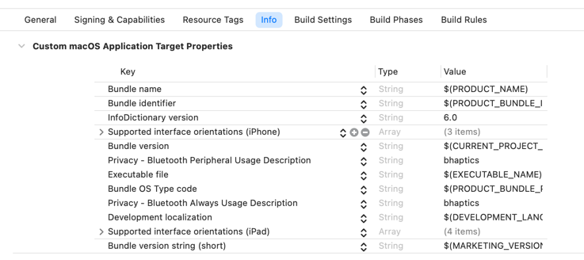
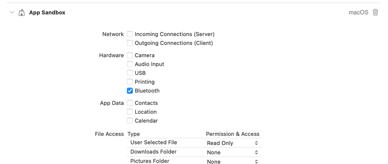

# bHaptics SDK for Apple platforms

Swift Package for controlling bHaptics devices (TactSuit, TactGlove, TactVisor, TactSleeve) from iOS, visionOS, and macOS apps.

## Supported platforms

| Platform | Minimum version | Device connection |
|---|---|---|
| iOS | 13.0 | Bluetooth LE (direct) |
| visionOS | 2.0 | Bluetooth LE (direct) |
| macOS | 10.15 | [bHaptics Player](https://www.bhaptics.com/support/download) running on the same Mac |

* Xcode 16 or later is required.
* The package ships a prebuilt `BhapticsPlugin.xcframework` with `ios-arm64`, `ios-arm64_x86_64-simulator`, `xros-arm64`, `xros-arm64_x86_64-simulator`, and `macos-arm64_x86_64` slices. The binary is downloaded from the GitHub release that matches the package version.

## Installation (Swift Package Manager)

In Xcode, choose **File > Add Package Dependencies...** and enter:

```
https://github.com/bhaptics/bhaptics-ios
```

Or add it to your `Package.swift`:

```swift
dependencies: [
    .package(url: "https://github.com/bhaptics/bhaptics-ios", from: "1.0.0")
]
```

Then `import BhapticsPlugin` in your code.

## Setup

### App ID / API key

Create an app and deploy its haptic events on the [bHaptics Developer Portal](https://developer.bhaptics.com/). See [App and Event](https://docs.bhaptics.com/portal/app-and-event) for details. The App ID and API key are passed to `BhapticsKit.initialize`.

### Info.plist (iOS / visionOS / macOS)

bHaptics devices are Bluetooth peripherals, so both keys are required:

* [NSBluetoothAlwaysUsageDescription](https://developer.apple.com/documentation/bundleresources/information_property_list/nsbluetoothalwaysusagedescription)
* [NSBluetoothPeripheralUsageDescription](https://developer.apple.com/documentation/bundleresources/information_property_list/nsbluetoothperipheralusagedescription)



### macOS (Signing & Capabilities > App Sandbox)

* Check **Bluetooth** and **Outgoing Connections (Client)**.
* Install and run bHaptics Player. `BhapticsKit.initialize` connects to the local Player automatically.



## Quick start

```swift
import BhapticsPlugin

let kit = BhapticsKit(delegate: self)

// Fetch the deployed events for your app. Returns false if the request fails.
let ready = await kit.initialize(appId: "YOUR_APP_ID", apiKey: "YOUR_API_KEY", defaultSetting: "")

// iOS / visionOS: discover and pair devices over Bluetooth LE
kit.scan()
let devices = kit.getDevices()
kit.pair(device: devices[0])

// Play a deployed event
let requestId = kit.play(eventId: "my_event")
kit.playParam(eventId: "my_event", intensity: 1.0, duration: 1.0, angleX: 0, offsetY: 0)
kit.stopByRequestId(requestId)
kit.stopAll()

// Drive motors directly (intensity 0...100 per motor)
kit.playDot(position: BhapticsPosition.Vest.index, durationMillis: 300, arr: [Int](repeating: 100, count: 32))
kit.turnOffMotors()
```

Device and connection changes are delivered through `BhapticsKitDelegate`:

```swift
extension MyViewModel: BhapticsKitDelegate {
    func bHapticsKit(_ kit: BhapticsKit, bleStateChange state: Bool) {}
    func bHapticsKit(_ kit: BhapticsKit, deviceStateUpdated devices: [BhapticsDevice]) {}
    func bHapticsKit(_ kit: BhapticsKit, didConnect device: BhapticsDevice) {}
    func bHapticsKit(_ kit: BhapticsKit, didDisconnect device: BhapticsDevice) {}
    func bHapticsKit(_ kit: BhapticsKit, didFailToConnect device: BhapticsDevice, error: Error?) {}
}
```

## Sample app

`SampleApp/BhapticsSample` is a SwiftUI app for iOS, visionOS, and macOS that covers device scanning and pairing, direct motor playback (dot / path / glove waveform), and event playback.

1. Open `SampleApp/BhapticsSample/BhapticsSample.xcodeproj`. The project depends on this repository as a local package.
2. Set `appId` and `apiKey` in `BhapticsSample/View/BhapticsViewModel.swift`.
3. Select a destination and run.

## License

Use of the bHaptics SDK is subject to the [bHaptics SDK agreement](https://bhaptics.gitbook.io/license-sdk/). See [LICENSE](LICENSE).
